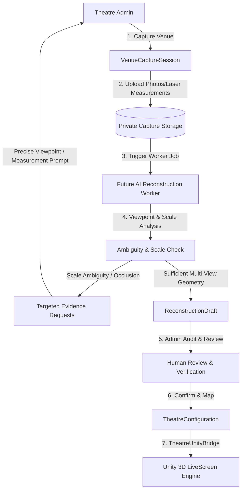
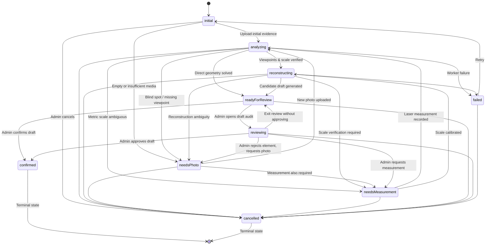

# AI Venue Capture Architecture (Foundation — Phase 1)

> **Core Foundational Principle:**
> *"AI assists reconstruction; it does not silently guess unknown measurements."*

---

## 1. Overview & System Workflow

The LiveScreen AI Venue Capture system allows theatre operators to capture and model real-world cinema auditoriums into interactive 3D digital twins. 

The complete target architecture operates as follows:

In Phase 1, the **architectural foundation** is established:
- Domain data models
- Explicit capture state machine
- Evidence traceability (`Estimate<T>`)
- Targeted evidence requests with precise viewpoints
- Separate `ReconstructionDraft`
- Safe `DraftToTheatreMapper` preserving identity and security
- Private Supabase schema & storage policies
- Future AI worker contracts
- Admin UI entry points in Create Theatre and Theatre Studio Editor

---

## 2. Key Architectural Constraints

1. **AI Output Is Never Live Configuration**: AI reconstruction output lives strictly in a private `ReconstructionDraft`. It is never automatically published to the production `TheatreConfiguration`.
2. **Never Silently Guess Unknowns**: Measurements preserve uncertainty via `Estimate<T>`. If a dimension is unknown, it remains explicitly `UNKNOWN`. It is never silently replaced with `0`, `false`, an empty string, or arbitrary demo constants.
3. **Protected Theatre Identity**: Mapping a draft into live configuration NEVER modifies:
   - Theatre ID (`id`)
   - Ownership (`ownerId`)
   - Platform Admin verification status (`verificationStatus`, `reviewReason`)
   - Publication status (`status`)
   - Movie content, bookings, or shows
4. **Visual-Only Speakers**: AI-detected speakers represent physical visual speaker cabinets only. AI does **not** infer audio channels (Left, Center, Surround, Overhead), Dolby/Atmos formats, or audio routing. `SpatialAudioManager` remains completely independent.

---

## 3. Capture State Machine

Sessions progress through an explicit state machine coordinated by `CaptureStateMachine`:

### Transition Enforcement
- Legal transitions are enforced in `CaptureStateMachine.transition(current, next)`.
- Illegal transitions throw `InvalidCaptureStateTransitionException`.
- Terminal states (`confirmed`, `cancelled`) cannot transition to any other state.

---

## 4. Evidence & Uncertainty Model (`Estimate<T>`)

### `Estimate<T>`
Measurements and spatial parameters are encapsulated in `Estimate<T>`:
- `value`: `T?`
- `provenance`: `measured` | `adminMeasured` | `inferred` | `aiEstimated` | `unknown`
- `source`: Tool or worker identifier (e.g., `laser_measure_bosch_glm50`, `nerf_depth_calibrator`)
- `confidence`: Normalized score between `0.0` and `1.0`
- `evidenceIds`: Stable UUIDs of media supporting this estimate
- `note`: Contextual or calibration notes

### Provenance Classification
- **`measured`**: Directly measured with physical measurement equipment (laser meter, architect drawings).
- **`adminMeasured`**: Manually measured by a verified theatre administrator on site.
- **`inferred`**: Geometrically or algebraically constrained from verified bounds.
- **`aiEstimated`**: Estimated from visual evidence by neural network / vision models.
- **`unknown`**: Explicitly unobserved and unestimated.

---

## 5. Targeted Evidence Requests

When reconstruction workers encounter missing angles, occluded equipment, or scale ambiguity, they generate `VenueCaptureRequest` objects.

Requests must **never** be generic (e.g. "Take another picture"). Instead, they specify:
- `target`: The specific element (e.g. `rear_left_surround_cluster`, `screen_bottom_bezel`)
- `reason`: The geometric ambiguity (e.g. `Ceiling height cannot be triangulated without high-angle view`)
- `requiredEvidenceType`: `photo` | `measurement`
- `instruction`: Clear, viewpoint-directed instructions (e.g. *"Take a photo from the rear-right aisle facing diagonally toward the rear-left wall, keeping the ceiling and speaker area visible."*)
- `priority`: `low` | `medium` | `high` | `critical`
- `status`: `pending` | `fulfilled` | `dismissed`

---

## 6. Coordinate Frame & Unity Alignment

LiveScreen uses a consistent coordinate convention matching Unity:

| Property | Value |
|---|---|
| **Units** | Metres ($1.0 = 1\text{m}$) |
| **Coordinate System** | Unity Left-Handed, Y-Up |
| **Origin $(0, 0, 0)$** | Front wall floor center (screen wall baseline) |
| **$+X$ Axis** | Lateral right (looking from front wall toward audience) |
| **$+Y$ Axis** | Vertical elevation above floor level |
| **$+Z$ Axis** | Depth from front wall toward back wall |
| **Seat Orientation** | $\text{rotationY} = 0^\circ$ faces $-Z$ (toward screen at $Z=0$) |
| **Screen Orientation** | $\text{rotationY} = 0^\circ$ faces $+Z$ (into auditorium) |

### Verification against Existing Unity Generators
- `RoomGenerator.cs`: Front wall sits at $Z = 0$, back wall at $Z = \text{roomLength}$, floor extends from $0$ to $\text{roomLength}$.
- `SeatGenerator.cs`: Seats are placed at positive $Z$ depths (`rowDepth = firstRowDistanceFromScreen + rowIndex * rowSpacing`) with `Quaternion.Euler(0, 180 + rotationY, 0)`, directly facing $-Z$.
- `CoordinateTransformer.dart`: Provides coordinate validation (`isWithinAuditorium`) and transform helpers for external CV pipelines.

---

## 7. Draft to Live Configuration Mapping

`DraftToTheatreMapper.applyDraftToConfiguration(...)` maps confirmed draft values to `TheatreConfiguration`:

1. **Review Requirement**: Rejects unreviewed drafts with `UnreviewedDraftException` unless `requireReviewed: false` is explicitly passed.
2. **Preservation of Known Dimensions**: Only known estimates (`estimate.isKnown`) update live configuration; unknown estimates leave original values untouched.
3. **Visual Speaker Isolation**:
   - Updates visual cabinet positions and cabinet types (`SpeakerType`).
   - Does **not** overwrite audio channel assignments or acoustic specifications.
4. **Security & Identity Preservation**:
   - `id`, `ownerId`, `verificationStatus`, `reviewReason`, `status`, `content`, and `acoustics` are strictly preserved from the live theatre.

---

## 8. Database Schema & Security (Supabase Migration 0012)

Migration `0012_venue_capture.sql` introduces:
- `venue_capture_sessions`
- `venue_capture_media`
- `venue_capture_observations`
- `venue_capture_requests`
- `venue_capture_jobs`

### Security Guarantees:
- **Private Capture Tables**: Capture evidence is stored in dedicated relational tables, never in the public `theatres.config` JSONB.
- **Row Level Security (RLS)**: Access is restricted to authorized operators using `public.is_authorized_theatre_admin(theatre_id)` and platform admins.
- **Private Storage Bucket**: `venue_capture_private` bucket with `public = false`.
- **Zero Client Secrets**: No external ML API keys, service role keys, or worker credentials exist in the Flutter client.

---

## 9. Future AI Worker Contracts

`lib/admin/capture/contracts/ai_worker_contracts.dart` specifies contracts for microservices:
1. `ViewpointAnalysisWorkerContract`: Coverage and blind-spot detection.
2. `SegmentationWorkerContract`: Surface partitioning (floor, walls, ceiling, screen).
3. `ObjectDetectionWorkerContract`: Screen bezel, chair units, speaker cabinets.
4. `DepthEstimationWorkerContract`: Metric depth mapping.
5. `MultiViewReconstructionWorkerContract`: Point cloud & room bounding extraction.
6. `ScaleCalibrationWorkerContract`: Calibration against ground-truth physical measurements.
7. `SeatLatticeDetectionWorkerContract`: Row and seat grid fitting.
8. `AppearanceEstimationWorkerContract`: Palette & material texture classification.
9. `EvidenceRequestPlannerContract`: Automated targeted request generation.

---

## 10. Phase 1 Scope & Limitations

### In Phase 1:
- Architectural foundation, domain models, state machine, repository layer, draft mapper, database migration, and test suite are implemented and verified.
- The UI exposes the capture workflow conceptually inside Create Theatre and Theatre Studio Editor.
- In-memory repository enables deterministic local testing.

### Deferred to Phase 2 (Future GPU/ML Pipeline):
- Integration of actual computer vision / photogrammetry pipelines (Structure from Motion, NeRF, 3D Gaussian Splatting).
- External worker daemon executing asynchronous jobs.
- Video stream keyframe extraction.
- Automatic edge and corner detection models.
