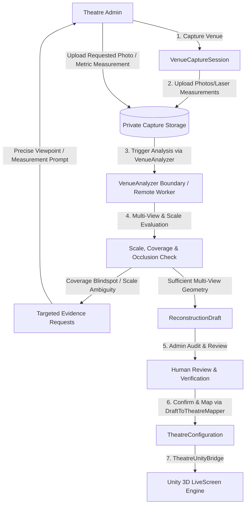
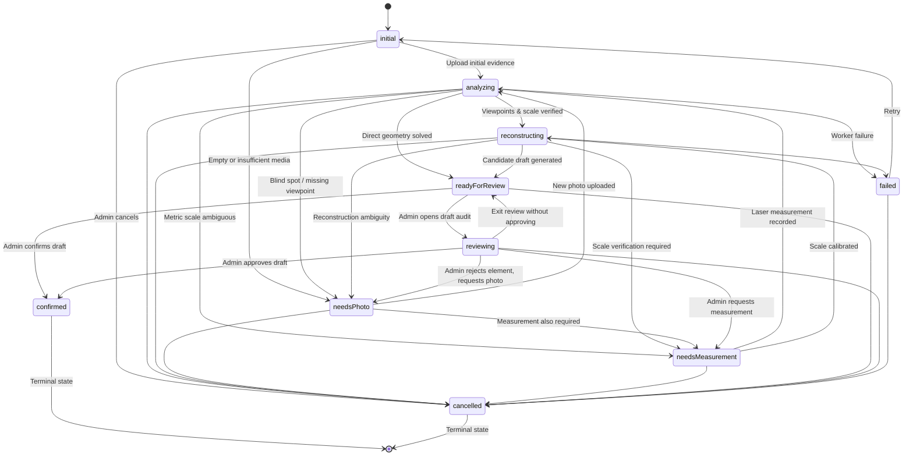
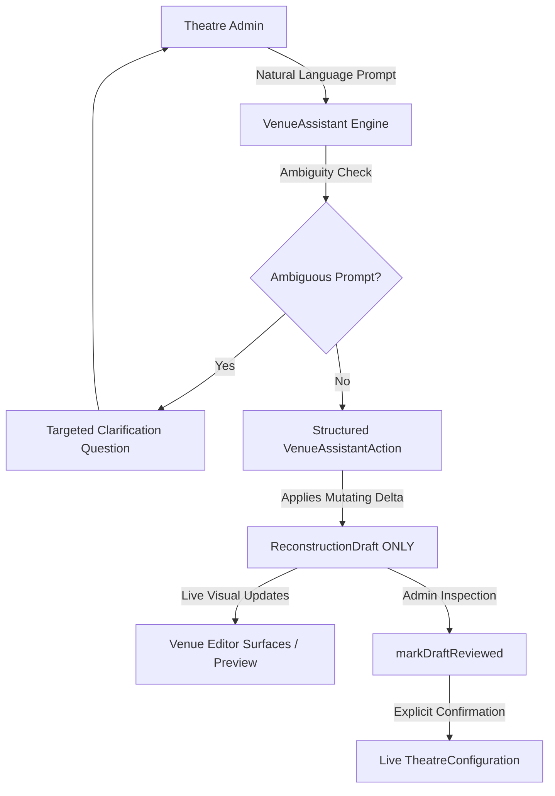

# AI Venue Capture Architecture (Phase 1 & Phase 2)

> **Core Foundational Principle:**
> *"AI assists reconstruction; it does not silently guess unknown measurements."*

---

## 1. Overview & System Workflow

The LiveScreen AI Venue Capture system allows cinema theatre operators to capture and model real-world auditoriums into interactive 3D digital twins. 

The complete system workflow operates as follows:



---

## 2. Key Architectural Constraints

1. **AI Output Is Never Live Configuration**: AI reconstruction output lives strictly in a private `ReconstructionDraft`. It is never automatically published to the production `TheatreConfiguration` or the database.
2. **Never Silently Guess Unknowns**: Measurements preserve uncertainty via `Estimate<T>`. If a dimension is unknown, it remains explicitly `UNKNOWN`. It is never silently replaced with `0`, `false`, an empty string, or arbitrary demo constants.
3. **Protected Theatre Identity**: Mapping a draft into live configuration NEVER modifies:
   - Theatre ID (`id`)
   - Ownership (`ownerId`)
   - Platform Admin verification status (`verificationStatus`, `reviewReason`)
   - Publication status (`status`)
   - Movie content, bookings, or shows
   - Acoustic parameters and room response profiles
4. **Visual-Only Speakers**: AI-detected speakers represent physical visual speaker cabinets only. AI does **not** infer audio channels (Left, Center, Surround, Overhead), Dolby/Atmos formats, or audio routing. `SpatialAudioManager` remains completely independent.
5. **No Client-Side ML Credentials**: No external ML API keys, service role keys, or GPU worker credentials exist in the Flutter client. Communication with external AI reconstructors occurs across a strict, injectable service boundary (`VenueAnalyzer`).
6. **Ephemeral Draft Sessions for New Theatres**: When capturing for a theatre that has not yet been saved to Supabase (e.g., inside `CreateTheatreScreen`), an ephemeral in-memory capture session is used. This prevents foreign key constraint violations against `theatres(id)` and ensures no phantom production rows are generated.

---

## 3. Four-Stage Interactive Capture Workflow (Phase 2 UI)

The `VenueCaptureScreen` provides a cinematic, four-stage workflow matching operator needs:

### Stage 1: Capture (Evidence Ingestion)
- **12 Evidence Categories**:
  - `screenFront`: Front wall and screen baseline
  - `frontLeft`: Front-left corner and speaker cluster
  - `frontRight`: Front-right corner and speaker cluster
  - `rearLeft`: Rear-left auditorium corner
  - `rearRight`: Rear-right auditorium corner
  - `backWall`: Projection booth and back wall
  - `ceiling`: Overhead beams and ceiling fixtures
  - `seatingGrid`: Auditorium rows and aisle rake
  - `sideWallLeft`: Left surround array and architectural baffles
  - `sideWallRight`: Right surround array and architectural baffles
  - `entranceExit`: Ingress/egress doors and pathways
  - `architecturalDetail`: Step risers, finishes, and equipment
- **Plain-English Guidance**: Each category includes contextual framing tips (e.g., *"Step back into the center aisle and capture the full screen frame from floor to ceiling"*).
- **Physical Scale Measurements**: Dedicated card to record ground-truth laser measurements (e.g., screen width, front row distance) with unit annotations and device sources (`laser_measure_bosch_glm50`, `architect_drawings`).
- **Upload States**: Tracks `pending`, `uploading`, `uploaded`, and `failed` per asset.

### Stage 2: Analysis & Targeted Requests
- **Worker Status Reporting**: Honest boundary indicator showing whether the backend reconstruction worker is connected or unconfigured.
- **Targeted Evidence Requests**: When multi-view geometry detects ambiguities or occlusions:
  - Highlights what element is uncertain (`target`).
  - Explains the exact geometric reason (`reason`).
  - Delivers actionable physical instructions (`instruction`).
  - Highlights priority (`critical`, `high`, `medium`, `low`).
  - Provides direct one-click fulfillment actions (`Capture Photo` / `Record Measurement`) linking back to Stage 1.
- **Re-Analysis Loop**: As targeted requests are fulfilled, the operator triggers re-analysis until all critical requests are satisfied and the session advances to `readyForReview`.

### Stage 3: Reconstruction (Candidate Draft Inspection)
- Inspects the isolated candidate `ReconstructionDraft`:
  - **Room Bounds**: Width, length, and ceiling height with confidence badges.
  - **Screen Geometry**: Width, height, bottom bezel elevation, curvature radius.
  - **Seating Lattice**: Rows, seats per row, row spacing, seat spacing, tier riser slope.
  - **Visual Speaker Array**: Detected cabinet positions, elevations, and cabinet types (visual only).
  - **Finishes & Lighting**: Wall, ceiling, seat materials and primary ambient lux levels.

### Stage 4: Review & Confirm (Enforced Administrator Review)
- **Confidence & Provenance Badges**: Every parameter displays its data origin (`measured`, `adminMeasured`, `aiEstimated`, `inferred`, `unknown`) and numeric confidence percentage.
- **Side-by-Side Configuration Diff**: Shows current live values alongside candidate draft values with visual indicators (`Updated`, `Unchanged`, `Preserved`).
- **Pre-Confirmation Safety Checklist**: 4-point human verification verifying:
  - Physical scale ground-truth verified
  - Screen dimensions match auditorium proportions
  - Seating layout matches physical row configuration
  - Speaker cabinets represent visual fixtures only
- **Enforced Two-Step Review Sequence**:
  1. Candidate draft generated.
  2. Administrator inspects draft and confirms audit checklist.
  3. `markDraftReviewed(actual authenticated admin ID)` records reviewer ID and timestamp in database/repository state.
  4. Explicit confirmation prompt.
  5. `confirmDraft(...)` verifies `draft.isReviewed` and transitions to `confirmed`.
  6. `DraftToTheatreMapper` maps confirmed draft values to `TheatreConfiguration`.
  - **Safety Guarantee**: If draft is unreviewed, confirmation throws `UnreviewedDraftException` and live configuration remains 100% untouched.

---

## 4. Capture State Machine

Sessions progress through an explicit state machine coordinated by `CaptureStateMachine`:



### Transition Enforcement
- Legal transitions are enforced in `CaptureStateMachine.transition(current, next)`.
- Illegal transitions throw `InvalidCaptureStateTransitionException`.
- Terminal states (`confirmed`, `cancelled`) cannot transition to any other state.
- `confirmDraft` cannot be called on sessions in `initial`, `needsPhoto`, `needsMeasurement`, or `analyzing`.

---

## 5. Injectable AI Worker Boundary (`VenueAnalyzer`)

To ensure clean decoupling between Flutter UI and backend reconstruction services, LiveScreen introduces the `VenueAnalyzer` service contract:

```dart
abstract class VenueAnalyzer {
  Future<VenueAnalysisResult> analyze(VenueAnalysisInput input);
}
```

### Implementations:
1. **`UnavailableVenueAnalyzer`** (Production Default):
   - Returns a structured unavailable status when no external GPU worker or queue daemon is connected.
   - Provides honest, zero-fake UI messaging informing the admin that the reconstruction pipeline is offline or awaiting infrastructure provisioning.
   - The production UI defaults to this and never silently runs mock geometry.
2. **`MockVenueAnalyzer`** (Deterministic Test Fixture Only):
   - **TEST & DEVELOPMENT ONLY**: Strictly used in automated test suites and local development simulations.
   - Values such as `22.4m` (room width), `28.5m` (room length), `8.2m` (room height), `16.2m` (screen width), and `7.2m` (screen height) are **deterministic test fixtures only** and NOT real computer-vision reconstruction.
   - Generates speaker candidates ONLY when actual speaker evidence exists. Every generated speaker has supporting evidence IDs. Never invents placeholder speakers or empty evidence IDs.
   - If metric scale is unknown, seating spacing (`seatSpacing`, `rowSpacing`, `rowRise`) remains `UNKNOWN`, and physical seat positions are NOT generated using arbitrary metre values. Existing baseline seating geometry is preserved if present.
3. **`FailingVenueAnalyzer`**:
   - Simulates pipeline timeouts or worker crashes to verify graceful failure handling and UI error recovery.

### Global Configuration & Dependency Injection:
- `venueAnalyzer`: Global active analyzer instance. Defaults to `UnavailableVenueAnalyzer`.
- `setVenueAnalyzer(analyzer)`: Dynamically injects an analyzer (used by test suites).
- `resetVenueAnalyzer()`: Restores the default `UnavailableVenueAnalyzer`.

---

## 6. Evidence & Uncertainty Model (`Estimate<T>`)

Measurements and spatial parameters are encapsulated in `Estimate<T>`:
- `value`: `T?`
- `provenance`: `measured` | `adminMeasured` | `inferred` | `aiEstimated` | `unknown`
- `source`: Tool or worker identifier (e.g., `laser_measure_bosch_glm50`, `nerf_depth_calibrator`)
- `confidence`: Normalized score between `0.0` and `1.0`
- `evidenceIds`: Stable UUIDs of media supporting this estimate
- `note`: Contextual or calibration notes

### Provenance Classification
- **`measured`**: Directly measured with physical measurement equipment (laser meter, architect drawings).
- **`adminMeasured`**: Manually measured by a verified theatre administrator on site.
- **`inferred`**: Geometrically or algebraically constrained from verified bounds.
- **`aiEstimated`**: Estimated from visual evidence by neural network / vision models.
- **`unknown`**: Explicitly unobserved and unestimated.

---

## 7. Targeted Evidence Requests

When reconstruction workers encounter missing angles, occluded equipment, or scale ambiguity, they generate `VenueCaptureRequest` objects.

Requests specify:
- `target`: The specific element (e.g. `rear_left_surround_cluster`, `screen_bottom_bezel`)
- `reason`: The geometric ambiguity (e.g. `Ceiling height cannot be triangulated without high-angle view`)
- `requiredEvidenceType`: `photo` | `measurement`
- `instruction`: Clear, viewpoint-directed instructions (e.g. *"Take a photo from the rear-right aisle facing diagonally toward the rear-left wall, keeping the ceiling and speaker area visible."*)
- `priority`: `low` | `medium` | `high` | `critical`
- `status`: `pending` | `fulfilled` | `dismissed`
- `fulfilledEvidenceId`: ID of the uploaded photo or measurement that satisfied the request.

---

## 8. Coordinate Frame & Unity Alignment

LiveScreen uses a consistent coordinate convention matching Unity:

| Property | Value |
|---|---|
| **Units** | Metres ($1.0 = 1\text{m}$) |
| **Coordinate System** | Unity Left-Handed, Y-Up |
| **Origin $(0, 0, 0)$** | Front wall floor center (screen wall baseline) |
| **$+X$ Axis** | Lateral right (looking from front wall toward audience) |
| **$+Y$ Axis** | Vertical elevation above floor level |
| **$+Z$ Axis** | Depth from front wall toward back wall |
| **Seat Orientation** | $\text{rotationY} = 0^\circ$ faces $-Z$ (toward screen at $Z=0$) |
| **Screen Orientation** | $\text{rotationY} = 0^\circ$ faces $+Z$ (into auditorium) |

### Verification against Existing Unity Generators
- `RoomGenerator.cs`: Front wall sits at $Z = 0$, back wall at $Z = \text{roomLength}$, floor extends from $0$ to $\text{roomLength}$.
- `SeatGenerator.cs`: Seats are placed at positive $Z$ depths (`rowDepth = firstRowDistanceFromScreen + rowIndex * rowSpacing`) with `Quaternion.Euler(0, 180 + rotationY, 0)`, directly facing $-Z$.
- `CoordinateTransformer.dart`: Provides coordinate validation (`isWithinAuditorium`) and transform helpers for external CV pipelines.

---

## 9. Draft to Live Configuration Mapping

`DraftToTheatreMapper.applyDraftToConfiguration(...)` maps confirmed draft values to `TheatreConfiguration`:

1. **Review Requirement**: Rejects unreviewed drafts with `UnreviewedDraftException` unless `requireReviewed: false` is explicitly passed.
2. **Preservation of Known Dimensions**: Only known estimates (`estimate.isKnown`) update live configuration; unknown estimates leave original values untouched.
3. **Seating Layout Measurement Preservation**:
   - If draft seating spacing, row spacing, or rise is unknown, the mapper preserves the corresponding value from `original.lastSeatLayout`.
   - Fallback defaults are only used if no previous layout exists at all.
4. **Visual Speaker Isolation**:
   - Updates visual cabinet positions and cabinet types (`SpeakerType`).
   - Does **not** overwrite audio channel assignments or acoustic specifications.
5. **Security & Identity Preservation**:
   - `id`, `ownerId`, `verificationStatus`, `reviewReason`, `status`, `content`, and `acoustics` are strictly preserved from the live theatre.

---

## 10. Database Schema & Security (Supabase Migration 0012)

Migration `0012_venue_capture.sql` introduces:
- `venue_capture_sessions`
- `venue_capture_media`
- `venue_capture_observations`
- `venue_capture_requests`
- `venue_capture_jobs`

### Security Guarantees:
- **Private Capture Tables**: Capture evidence is stored in dedicated relational tables, never in the public `theatres.config` JSONB.
- **Row Level Security (RLS)**: Access is restricted to authorized operators using `public.is_authorized_theatre_admin(theatre_id)` and platform admins.
- **Private Storage Bucket**: `venue_capture_private` bucket with `public = false` and scoped RLS policies for authenticated operators.
- **Zero Client Secrets**: No external ML API keys, service role keys, or worker credentials exist in the Flutter client.

---

## 11. Phase 2 Status & Future GPU Worker Integration

### Implemented in Phase 1 & 2:
- Complete Flutter capture UI/UX workflow with 4 tabs (Capture, Analysis, Reconstruction, Review & Confirm).
- 12-category evidence ingestion with photographic framing guidance and upload state tracking.
- Physical scale measurement cards supporting laser distance meters and architectural blueprints.
- Explicit state machine with transition validation and protection against unreviewed draft confirmations.
- Injectable `VenueAnalyzer` boundary (`UnavailableVenueAnalyzer`, `MockVenueAnalyzer`, `FailingVenueAnalyzer`).
- Targeted evidence requests with priority levels and direct fulfillment links.
- Candidate `ReconstructionDraft` visualization across room, screen, seats, visual speakers, lighting, and materials.
- Confidence & Provenance audit badges for all reconstructed parameters.
- Pre-confirmation 4-point safety checklist and side-by-side configuration diff.
- Safe `DraftToTheatreMapper` preserving theatre identity, ownership, acoustics, and existing seat parameters.
- Ephemeral in-memory capture sessions for unpersisted theatres in `CreateTheatreScreen`.
- Automated test suite covering the entire pipeline.

### Deferred to Future External GPU Worker Integration:
- Ingestion of real-time camera streams / video keyframe extraction via hardware decoders.
- Deep-learning surface segmentation (e.g., SAM 2 / Segment Anything models running on remote GPU instances).
- Structure-from-Motion (SfM) feature matching and NeRF / 3D Gaussian Splatting dense reconstruction pipelines.
- Asynchronous GPU worker daemon consuming `venue_capture_jobs` queue records from Supabase.

---

## 12. Phase 3: Conversational AI Venue Assistant & Floating Circular Popup UI

Phase 3 introduces an intelligent, natural-language conversational assistant tailored strictly for theatre administrators configuring auditoriums.



### 12.1 Separation of Concerns: Logical Structure vs. Physical Geometry
- **Logical Venue Structure (Authoritative Admin)**: The theatre admin is authoritative for counting and arranging logical elements:
  - Row counts (e.g., *"There are 12 rows."*)
  - Default seats per row (e.g., *"There are 16 seats in each row."*)
  - Seating block counts (e.g., *"There are 3 seating blocks."*)
  - Aisle positions (e.g., *"Put an aisle after seat 4 and after seat 12."* $\rightarrow$ 4 seats | aisle | 8 seats | aisle | 4 seats)
  - Aisle removal (e.g., *"Actually remove the aisle after seat 12."* $\rightarrow$ 4 seats | aisle | 12 seats)
  - Irregular row counts (e.g., *"Rows 1 to 5 have 16 seats and rows 6 to 12 have 18."*)
  - Missing/column-obstructed seats (e.g., *"Remove seat 7 from row 5."*)
- **Physical Venue Geometry (Evidence/Reconstruction Driven)**:
  - Metric spacing (`seatSpacing`, `rowSpacing`, `rowRisePerRow`, `aisleWidth`) remains strictly `UNKNOWN` unless established from evidence.
  - Arbitrary physical measurements (e.g. 0.6m, 1.1m) are **never** invented or fabricated.
  - When scale is required, the assistant triggers a targeted physical measurement request.

### 12.2 Draft-Only Safety Principle
- Assistant actions modify `ReconstructionDraft` **only**.
- They never directly modify `TheatreConfiguration`.
- The human review and explicit confirmation pipeline (`markDraftReviewed` $\rightarrow$ `confirmDraft` $\rightarrow$ `DraftToTheatreMapper`) remains mandatory before any assistant change affects production.

### 12.3 Ambiguity & Clarification Handling
- The assistant never silently guesses operator intent.
- Prompts like *"Make the aisle wider"* trigger clarification: *"Which aisle should I change — the aisle after seat 4 or the aisle after seat 12?"*
- Prompts like *"Move the screen back"* trigger clarification: *"Do you mean farther from the seating area or closer to it?"*

### 12.4 Undo & Revision Engine
- Operators can say *"Undo that"* or tap the `+ Undo` chip.
- The assistant restores the prior `ReconstructionDraft` snapshot from the session's action history.

### 12.5 Floating Circular Popup UI Specifications
- **Design Language**: Master dark cinematic palette:
  - Deep black (`#0C0C10`)
  - Metallic gold accent (`#D4AF37`)
  - Subtle burgundy accent (`#5A1226`)
  - Warm off-white (`#F7F5F0`)
- **Closed State**:
  - Small circular floating button (54×54 dp) at the bottom-right.
  - Subtle gold border and sparkle/AI icon (`Icons.auto_awesome`).
  - Underlying venue configuration remains completely interactive and unblocked.
- **Open State**:
  - Smooth expansion into a compact popup card (max 380×520 dp).
  - Header displays `AI VENUE ASSISTANT` and the dynamic active context name (e.g., *"Seating Configuration"*).
  - Quick action suggestion chips (`+ 12 rows`, `+ 16 seats/row`, `+ 3 blocks`, `+ Aisles after 4 & 12`, `+ Request measurement`, `+ Undo`).
  - Closing ('×') smoothly collapses the popup without clearing conversation history.
- **Session Scoping & Continuity**:
  - `VenueAssistantRegistry` manages assistant instances by `sessionId`.
  - Closing and reopening the popup preserves all previous message turns and draft snapshots.

### 12.6 Restricted Surfaces
- **Allowed Only In**:
  - `CreateTheatreScreen` $\rightarrow$ Capture with AI
  - `VenueCaptureScreen` (AI Venue Capture)
  - `TheatreEditorScreen` (Room, Screen, Seating, Speakers, Acoustics, Movie, Preview tabs)
- **Strictly Prohibited From**:
  - Customer Home, Movies, Movie Details, Booking, Seat Selection, Snacks, Payment, My Bookings, Profile, Settings
  - Producer screens and dashboards
  - Platform Admin screens and dashboards

---

## 13. Phase 4 — Real AI Venue Reconstruction Worker Foundation

### 13.1 Architecture Overview & Clear System Separation
LiveScreen enforces strict boundaries between subsystem responsibilities:

```mermaid
flowchart TD
    Photos[Photos / Video / Measurements] --> Ingestion[Evidence Ingestion]
    Ingestion --> AIWorker[External AI Reconstruction Worker\n(Perception / Geometry / Evidence / Confidence)]
    AIWorker --> Result[VenueReconstructionResult]
    Result --> Merge[DraftMergeEngine\n(Precedence & Logical Constraint Protection)]
    Merge --> Draft[ReconstructionDraft]
    Draft --> TargetReq[Targeted Uncertainty Requests\n(Specific Angles / Tape Measurements)]
    TargetReq -.->|More Evidence| Ingestion
    Draft --> AdminReview[Admin Inspection & Review]
    AdminReview --> Confirmation[markDraftReviewed + confirmDraft]
    Confirmation --> Mapper[DraftToTheatreMapper]
    Mapper --> LiveConfig[Live TheatreConfiguration]
    LiveConfig --> UnityBridge[TheatreUnityBridge]
    UnityBridge --> UnityPayload[TheatreConfigPayload]
    UnityPayload --> UnityGenerators[Unity Procedural Generators\n(Room, Screen, Seats, Speakers)]
```

- **AI Reconstruction Worker**: Perception, multi-view geometry, scale calibration, semantic feature detection, confidence scoring, targeted request generation. **The worker is NOT Unity.**
- **Flutter**: Capture workflow, evidence upload, conversational assistant, administrative inspection, review, and explicit confirmation.
- **Supabase**: Persistent storage, relational sessions/jobs/evidence, Row Level Security (RLS) enforcement.
- **Unity**: 3D visual reconstruction and procedural generation strictly rendered from confirmed canonical `TheatreConfiguration` via `TheatreUnityBridge`. **No AI reconstruction logic resides in Unity.**

---

### 13.2 What is IMPLEMENTED vs. FUTURE / NOT YET DEPLOYED

#### IMPLEMENTED (Phase 4 Foundation):
1. **Typed Worker Contracts**: Explicit schemas for `VenueReconstructionInput`, `VenueReconstructionResult`, `VenueObservation`, `LogicalVenueConstraints`, `VenueCaptureJob`, `VenueReconstructionConflict`, and `ScaleStatus`.
2. **Deterministic Reference Worker**: `ReferenceVenueReconstructionWorker` in Flutter (`lib/admin/capture/services/reference_reconstruction_worker.dart`) for reproducible automated testing and local development against synthetic venue fixtures (Fixtures A through H).
3. **Production Offline Protection**: `UnavailableReconstructionWorker` as production default. Honestly informs the admin that no external worker endpoint is connected; never fabricates results.
4. **Controlled Draft Merge Engine**: `DraftMergeEngine` enforcing strict Estimate precedence (`MEASURED` > `ADMIN_MEASURED` > `AI_ESTIMATED` > `INFERRED` > `UNKNOWN`), preserving admin logical seating structure, detecting conflicts, and preventing uncalibrated metric contamination.
5. **Multi-View Perception & Evidence Traceability**: Observations and reconstructed elements cite supporting `evidenceIds`.
6. **Scale Calibration Logic**: Distinguishes `known`, `calibrated`, and `unknown` scale. Keeps physical dimensions `UNKNOWN` and physical seat positions empty when scale cannot be established.
7. **Conflict Detection & Targeted Requests**: Detects discrepancies between vision (e.g. 11 visible rows) and admin specification (e.g. 12 rows). Issues specific, actionable photographer positioning directions.
8. **Iterative Reconstruction Pipeline**: Multi-pass refinement (`refine()`) where pass 1 discovers ambiguity, requests evidence, and pass 2 combines prior observations with newly uploaded media.
9. **Unity Integration Continuity**: Confirmed `ReconstructionDraft` maps cleanly through `DraftToTheatreMapper` to canonical `TheatreConfiguration` and into `TheatreUnityBridge.toUnityPayload()`.
10. **Python Worker Foundation**: Clean Python worker package in `worker/` with contracts, geometry, perception, seating, evidence, confidence, fusion, and unit test suite.

#### FUTURE / NOT YET DEPLOYED:
1. **GPU Worker Deployment**: No Docker containers or cloud GPU endpoints deployed yet.
2. **Model Weight Hosting**: Pretrained depth models (e.g., Depth Anything V2, ZoeDepth), segmentation models (SAM 2, Mask2Former), and multi-view Structure-from-Motion (COLMAP, VGGSF) will run on external GPU infrastructure.
3. **Video Walkthrough Reconstruction**: Video upload is accepted and preserved in evidence schemas, but video photogrammetry/SLAM processing is stubbed with honest notices until GPU frame extractors are connected.
4. **Paid AI API Keys**: Zero cloud AI keys or billing dependencies in client apps.

---

### 13.3 Worker Contracts & Schemas

#### 13.3.1 Worker Input (`VenueReconstructionInput`)
- `jobId`: Unique job identifier.
- `sessionId`: Session UUID.
- `theatreId`: Target theatre identifier if assigned.
- `evidence`: List of `VenueCaptureMedia` items (photos, videos, measurements).
- `baselineDraft`: Existing candidate draft (if refining).
- `logicalConstraints`: Authoritative admin constraints (`rows`, `seatsPerRow`, `blockCount`, `aisleAfterSeats`, `rowSeatCounts`, `removedSeats`, `aisleWidth`).
- `knownMeasurements`: Direct tape/laser measurements (e.g. `roomWidth`, `screenWidth`).
- `coordinateConvention`: Coordinate frame specification.
- `requestedAnalysis`: List of target modules (`room`, `screen`, `seating`, `speakers`, `lighting`, `appearance`).
- `previousObservations`: List of prior `VenueCaptureObservation` entities from earlier passes.
- `revision`: Reconstruction pass revision (1, 2, ...).

#### 13.3.2 Worker Output (`VenueReconstructionResult`)
- `jobId`: Matching job identifier.
- `revision`: Result revision number.
- `scaleStatus`: `known`, `calibrated`, or `unknown`.
- `state`: `confident`, `uncertain`, `conflict`, `needsMeasurement`, `needsPhoto`, or `unsupported`.
- `observations`: List of typed `VenueObservation` items with provenance, confidence, and `evidenceIds`.
- `room`: `DraftRoomGeometry` (`width`, `length`, `height`).
- `screen`: `DraftScreen` (`width`, `height`, `position`, `rotationY`, `type`).
- `seating`: `DraftSeatLattice` (`rows`, `seatsPerRow`, `seatSpacing`, `rowSpacing`, `rowRisePerRow`, `seats`, etc.).
- `speakers`: List of `DraftVisualSpeaker` (strictly visual cabinets with evidence IDs).
- `lighting`: `DraftLighting` (`ceilingLightsCount`, `hasAisleLighting`, `estimatedLux`).
- `appearance`: `DraftAppearance` (`wallColorHex`, `carpetColorHex`, `wallMaterialType`).
- `overallConfidence`: Aggregated confidence metric (0.0 to 1.0).
- `evidenceLinks`: Map linking architectural elements to evidence IDs.
- `requests`: Actionable `VenueCaptureRequest` items for missing angles or tape measurements.
- `conflicts`: List of `VenueReconstructionConflict` items.
- `warnings`: Explanatory operational notices.

---

### 13.4 Scale Calibration & Truth in Reconstruction
Scale is foundational to physical realism:
- **Known Scale**: Tape/laser measurements provided directly by admin.
- **Calibrated Scale**: Physical distance evidence uploaded (e.g. calibrated target, ruler in scene, measured door/screen dimension).
- **Unknown Scale**: Only photographs without metric references.
  - **Metric values are NEVER fabricated**: `roomWidth`, `roomLength`, `seatSpacing`, `rowSpacing`, and `aisleWidth` remain explicitly `Estimate.unknown()`.
  - **No fake coordinates**: The physical seat positions list remains empty (`seats = const []`).
  - **Targeted Measurement Request**: Emits high-priority request:
    *"Measure the distance from the front wall to the first seating row (Row A), or measure the total width of the screen from edge to edge."*

---

### 13.5 Logical vs. Physical Seating Separation
1. **Admin Authority**: Admin provides logical count and layout (e.g., 12 rows, 16 seats/row, 3 blocks, aisles after 4 & 12).
2. **Worker Reconstruction**: AI worker detects physical geometry (seat spacing, row spacing, riser gradient, physical XYZ coordinates).
3. **Discrepancy Protection**:
   - If admin specifies 12 rows but AI vision only detects 11 visible rows (e.g. rear tier obscured):
   - **AI vision NEVER overwrites admin logical structure.**
   - Surfaces `ReconstructionUncertaintyState.conflict` and a `VenueReconstructionConflict`.
   - Generates a targeted photo request:
     *"Stand at the back-right corner of the auditorium, at standing eye height, face diagonally toward the screen, and ensure rows 9–12 are fully visible."*

---

### 13.6 Controlled Draft Merge Engine & Estimate Precedence
Merging worker results into a `ReconstructionDraft` follows strict precedence:

$$\text{MEASURED (4)} > \text{ADMIN\_MEASURED (3)} > \text{AI\_ESTIMATED (2)} > \text{INFERRED (1)} > \text{UNKNOWN (0)}$$

1. **Precedence Dominance**: A stronger provenance value is never overwritten by a weaker one. Direct on-site measurements beat AI estimates.
2. **Confidence Comparison**: When comparing two `AI_ESTIMATED` values, the estimate with higher confidence takes precedence.
3. **Unknown Never Overwrites Known**: An `UNKNOWN` worker candidate never clears an already established draft dimension.
4. **Draft Safety**: `DraftMergeEngine` produces a new immutable `ReconstructionDraft`. Live `TheatreConfiguration` is **never touched**. Every AI update resets `isReviewed = false` requiring explicit operator verification before confirmation.

---

### 13.7 Targeted Request Guidance Protocol
Targeted evidence requests must never issue generic instructions like *"Please upload more photos."* Every request specifies:
- **Target Feature**: Architectural element requiring clarification (e.g., *"Rear Seating Rows"*).
- **Technical Reason**: Explanation of ambiguity (e.g., *"11 rows detected vs 12 specified"*).
- **Standing Position**: Where the photographer must stand (e.g., *"Back-right corner of the auditorium"*).
- **Eye Height**: Camera elevation (e.g., *"Standing eye height"*).
- **Facing Direction**: Camera orientation (e.g., *"Diagonally toward the front wall screen"*).
- **Visibility Requirement**: What must be in frame (e.g., *"Rows 9 through 12 and the right aisle"*).

---

### 13.8 Python Worker Package Architecture (`worker/`)
For future external GPU execution, the worker foundation is mirrored in a clean Python package:
```
worker/
├── contracts/        # Data classes matching Flutter models (Job, Input, Result, Observation)
├── geometry/         # CoordinateFrame, RoomGeometryEstimator, ScreenGeometryEstimator
├── perception/       # DepthEstimator, ObjectDetector, SegmentationModel contracts
├── seating/          # SeatingLatticeExtractor with logical constraint enforcement
├── evidence/         # EvidenceStore partitioner and validator
├── confidence/       # ConfidenceScorer
├── reconstruction/   # MultiViewFusionEngine
├── pipeline/         # ReferenceVenueReconstructionWorker & UnavailableReconstructionWorker
└── tests/            # Automated test suite (test_contracts.py, test_reconstruction.py)
```
Zero heavy ML runtimes are bundled into Flutter. Client apps communicate exclusively via typed schemas.

---

### 13.9 Authenticated Reviewer Identity Resolution
In production, reviewer attribution is strictly tied to the active Supabase authentication context:
1. **Authenticated Session Authority**: `VenueCaptureScreen` and `SupabaseVenueCaptureRepository` resolve `auth.currentUser.id` as the primary identity.
2. **Owner ID Isolation**: A theatre's historical `config.ownerId` is never treated as proof of the identity of the person currently performing review or confirmation actions.
3. **Impersonation Prevention**: Caller-supplied `adminUserId` strings are ignored in production whenever an active authenticated session exists.
4. **Deterministic Testability**: An explicit test-only fallback to `adminUserId` is permitted exclusively in automated test harnesses or offline mocks where Supabase authentication is uninitialized.
5. **Fail-Closed Principle**: If no authenticated administrator identity can be safely resolved, the review and confirmation pipelines reject the request and display an explicit authentication required prompt.

---

### 13.10 Per-Wall Appearance & Material Reconstruction
`ReconstructionDraft` models visual appearance through both global palette estimates and distinct per-wall finish channels:
1. **Independent Wall Estimates**: `DraftWallAppearance` defines `colorHex`, `materialType` (e.g., `acoustic_fabric_panel`, `wood_slat`, `matte_proscenium`), and `patternTreatment` (e.g., `acoustic_baffles`, `diffuser_panel`) independently for `frontWall`, `leftWall`, `rightWall`, and `rearWall`.
2. **Provenance Hierarchy**: Wall appearance attributes adhere to `MEASURED > ADMIN_MEASURED > AI_ESTIMATED > INFERRED > UNKNOWN`.
3. **Non-Destructive Merging**: Missing visual evidence for one surface does not overwrite established properties on another surface or reset an existing baseline.
4. **Canonical Schema Boundary**: Canonical `TheatreConfiguration` and `RoomConfig` track metric bounding dimensions for the Unity runtime. Per-wall visual appearance channels remain in `ReconstructionDraft` without introducing breaking changes to live playback configurations or parallel Unity pipelines.
